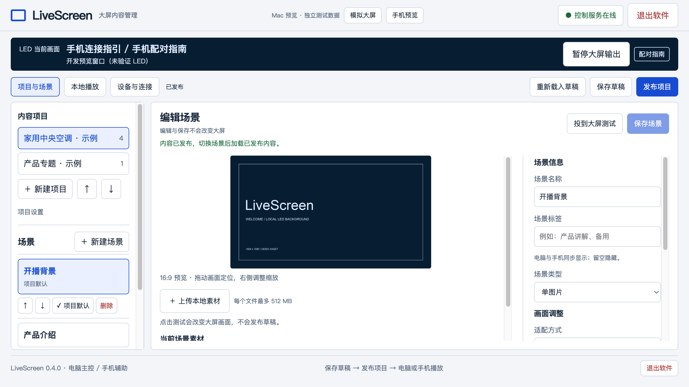

# LiveScreen

**大屏内容，从容掌控。**

开源的大屏内容管理与局域网控制工具。电脑负责管理和播放，手机辅助切换；适用于直播背景、展厅和活动大屏。

[产品介绍](https://arjuntam.github.io/LiveScreen/) · [下载软件](https://github.com/arjuntam/LiveScreen/releases/tag/v0.4.0) · [使用说明](docs/getting-started.md) · [反馈问题](https://github.com/arjuntam/LiveScreen/issues)



## 下载

| 系统 | 当前下载 | 适用设备 |
| --- | --- | --- |
| Windows | [Windows 0.3.5 安装包](https://github.com/arjuntam/LiveScreen/releases/download/v0.4.0/LiveScreen-Setup-0.3.5-x64.exe) | Windows 10 / 11，x64 |
| macOS | [Mac 0.4.0 安装磁盘](https://github.com/arjuntam/LiveScreen/releases/download/v0.4.0/LiveScreen-Mac-0.4.0-arm64.dmg) | Apple 芯片，macOS 13+ |

发布页同时提供两个系统已测试的安装包，版本号分别标明。仓库当前源码为 0.4.0，Windows 安装包保留此前测试过的 0.3.5。Intel Mac 安装包暂未提供。

安装包尚未取得 Windows 商业签名 / Apple Developer ID 公证；Mac 包有本地 ad-hoc 完整性签名。系统若阻止安装，请记录准确提示，不要关闭系统安全保护。下载后可对照发布页的 SHA256SUMS.txt 校验。

## 可以做什么

- **双屏输出**：手动绑定外接扩展屏；操作主屏、内置屏不可作为输出目标。断屏暂停并显示管理窗口，恢复需人工确认。
- **项目和场景**：图片、静音循环视频、手动多图或自动轮播；自定义名称、标签、顺序和默认场景。
- **编辑与播放分开**：画面适配、缩放、偏移与拖动预览；保存草稿、发布内容不会直接切掉当前大屏画面。
- **本机主控**：缩略图播放、任意跳页、暂停 / 继续轮播、未发布场景测试。操作冲突时本机优先。
- **手机辅助**：同一可互通网络内扫码，用随机配对码建立浏览器信任；多个手机同步播放状态。
- **远程管理**：其他电脑通过受口令保护的网页编辑和上传。文件复制到大屏电脑，上传设备无需一直在线。
- **后台运行**：关闭管理窗口后继续播放，托盘 / 菜单栏找回；明确退出才停止输出和网页服务。支持登录自启设置。

每次软件启动先显示配对指南；首台手机连接后，可按设置进入默认背景或上次正式场景。电脑也可以直接播放，无需手机。默认有 0.3 秒场景渐变，可以关闭。

## 快速开始

1. 将大屏设为**扩展显示器**，保留操作屏为主显示器。
2. 打开软件，在「设备与连接」中手动绑定大屏。
3. 创建项目 / 场景，上传 PNG、JPG、WebP 或 H.264 MP4，保存并发布。
4. 电脑「本地播放」选择场景；手机连可互通网络后扫码配对。
5. 关闭窗口只进入后台；暂停输出或退出软件后，可独立使用其他演示软件。

Wi-Fi 名称和配对地址会尝试自动识别；同时连接 Wi-Fi 与有线时优先展示无线地址。系统不提供 Wi-Fi 名称时可以填写备用名称。DHCP / 切网后每 5 秒更新地址和二维码；二维码无法绕过客户端隔离或防火墙。

## 素材和数据

- Windows：`%APPDATA%/livescreen/`。
- Mac 正式版：`~/Library/Application Support/LiveScreen/`。
- 素材在该目录的 `media/` 下；项目、设置和凭证也保存在本机。升级前请备份整个数据目录，勿将其提交到 GitHub。
- 每个文件上限 512 MB，并保留至少 1 GB 磁盘空间。建议使用 1080p H.264 MP4；容器检查不等于完整编码兼容保证。
- 独立的 Mac 预览使用自己的测试目录，不自动复制正式版项目。两台电脑之间不自动同步素材。

示例图片、视频和图标是本工程的技术示例；不包含公司素材或企业网络认证截图。自己的素材需要有相应使用权。

## 局域网使用边界

HTTP 服务只监听 loopback 与当前成功绑定的私有 IPv4 地址，只接受本机及相应子网请求；有 Host / Origin / CSRF 校验、角色权限和配对限速。手机不能修改项目、设置或退出主机；远程管理不能执行显示器绑定、自启或主机退出。

**仅在受信任局域网使用。HTTP 不加密，不要把端口转发到公网。** 不同 VLAN、访客网络、设备隔离、操作系统隐私权限和防火墙可能阻止手机访问。软件不接管路由器或系统安全设置。

## 开发

Node.js 22+，使用锁定依赖：

```sh
npm ci
npm run check
npm test
npm run preview
```

`npm run preview` 使用独立测试数据和窗口式模拟大屏。仅测试网页与交互时无需连接真实大屏。原生软件：`npm start`。

界面集成测试使用 Electron 与 Microsoft Edge：先安装 Edge，再执行 `npm run test:ui`。Mac 原生专用用例在 Windows 跳过。移动视口测试不等于真实手机和网络验收。

```sh
npm run build:win          # Windows x64 NSIS
npm run build:mac          # 在 Mac 上生成 Apple 芯片应用、ZIP、DMG
node scripts/verify-mac.cjs
```

Mac 开发包使用 ad-hoc 签名；公开可信分发仍需发布者配置 Developer ID 签名和公证。首次安装 / 构建需要下载 Electron 和打包工具。安装器源码在 `build/`，本机数据不进入安装包。

## 项目结构

- `src/core/`：项目、认证、HTTP / SSE 服务与播放状态。
- `src/desktop/`：Electron 窗口、显示器、后台入口、网络检测与登录项。
- `src/player/`：播放、预加载、渐变、图片翻页与配对指南。
- `web/`：软件管理界面与手机控制页。
- `site/`：产品介绍页；GitHub Pages 只部署这个目录，不部署主机控制服务。
- `tests/`：核心与界面测试；`scripts/`：检查和打包工具。

## 当前状态

维护者已完成本机使用测试。自动化基线：78 项核心/API、29 项 Electron/Edge 流程通过；Mac 应用启动、窗口找回、退出与包完整性已验证。不同显卡、真实大屏拔插、长时间播放、真实手机网络、自启和 Windows 安装升级仍需针对自己的环境验证。这不是对所有设备的兼容性保证。

不提供手机屏幕镜像、直播推流、PPT 解析、自由图层时间轴、云端账号或公网穿透。EDID 硬件识别、素材垃圾回收、完整编码预检、自动更新和主进程看门狗尚未实现。

## 开源许可

[MIT](LICENSE) © 2026 arjuntam。第三方依赖保留各自许可，见 [第三方许可说明](THIRD-PARTY-NOTICES.txt)。欢迎提交具体、可复现的问题和小范围改进，见 [贡献说明](CONTRIBUTING.md)。
